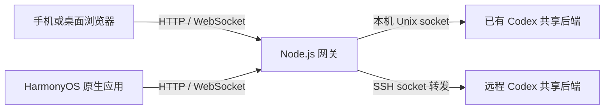

# Codex Phone

从手机查看、继续和控制电脑上的 Codex 会话。

Codex Phone 是一个自托管的移动端接入项目，包含响应式网页、HarmonyOS 原生应用和 Node.js 网关。网关连接电脑上**已经运行的 Codex 共享后端**，让你离开电脑后仍能查看任务进度、发送文字或图片、追加指令，以及处理审批。也可以由网关通过 SSH 接入远程开发机。

本项目是独立的社区项目，与 OpenAI 无官方隶属关系。

[快速开始](#快速开始) · [使用指南](#使用指南) · [架构与模块](#架构与模块) · [开发与贡献](#开发与贡献) · [文档导航](#文档导航)

## 功能概览

| 场景       | 支持的操作                                                            |
| ---------- | --------------------------------------------------------------------- |
| 浏览会话   | 查看历史、搜索标题、按完整工作路径分组、分页加载                      |
| 继续工作   | 新建或接续会话，发送文字和图片，查看流式回复与工具过程                |
| 控制任务   | 在运行中追加指令、停止当前任务、响应审批与交互问题                    |
| 调整会话   | 选择项目、模型、推理强度与 Plan 模式，具体能力取决于后端              |
| 连接机器   | 接入本机及 SSH 目标；原生应用可保存多个网关，网页切换当前网关下的机器 |
| 恢复与管理 | 草稿保存、断线后同步、一次性配对、查看及撤销已授权客户端              |

**接入前提：Codex 必须提供可连接的共享 control socket，并支持适配器所需协议。** 不同 Codex 版本、Desktop 与 CLI 运行方式可能使用不同后端。能读取历史不代表能控制另一个进程的任务；跨端控制需要按[验收清单](docs/ACCEPTANCE.md)验证。项目处于早期开发阶段，协议兼容范围见[适配器说明](server/codex-protocol.md)。

## 架构与模块



网关负责配对、设备授权、文件上传和协议转换，通过统一的 `/api/v1` 接口服务两种客户端。会话和任务在 Codex 后端执行，电脑端的权限与审批策略继续生效；网关不会为接入另起独立的 Codex app-server。

| 目录                            | 模块与职责                                                                  |
| ------------------------------- | --------------------------------------------------------------------------- |
| [`web/`](web/)                  | React + TypeScript 网页，包含会话浏览、对话界面、设备管理及客户端状态       |
| [`harmony/`](harmony/README.md) | ArkTS / ArkUI 原生应用，包含原生界面、相册选择、凭据存储与网络连接          |
| [`server/`](server/)            | Node.js 网关，负责 HTTP/WS、认证、Codex 协议适配、本机及 SSH 目标、图片传输 |
| [`shared/`](shared/)            | 网页与网关共用的 TypeScript 协议类型；原生应用维护对应的 ArkTS 类型         |
| [`scripts/`](scripts/)          | 连接诊断、真实后端验收、macOS 服务配置生成及 HarmonyOS 构建工具             |
| [`tests/`](tests/)              | 网关、协议、网页状态、SSH 传输与原生逻辑的自动测试                          |
| [`docs/`](docs/)                | 部署、接口、验收和资源说明                                                  |

一个 **Server（网关）** 是客户端配对的入口；一个 **目标机器** 是网关接入的本机或 SSH 开发机。设备授权属于网关，会话、模型和上传图片按目标机器隔离。已配对客户端可访问该网关配置的全部目标，适合个人设备使用。

## 快速开始

### 1. 准备环境

- Node.js **22.13 或更新版本**，以及 npm；使用 nvm 时可运行 `nvm install && nvm use`。
- 已登录并运行的 Codex，以及当前用户可访问的共享 control socket。默认路径为 `~/.codex/app-server-control/app-server-control.sock`；自定义路径通过 `socketPath` 配置。
- 网关及目标机器使用支持 Unix socket 的环境，主要面向 macOS / Linux。HarmonyOS 客户端构建另需 DevEco Studio，见[原生工程说明](harmony/README.md)。

### 2. 安装与启动网关

克隆仓库并进入项目根目录后运行：

```sh
npm ci
test -f config.local.json || cp config.example.json config.local.json
npm run build
npm run doctor
npm start
```

`config.local.json` 是不进入 Git 的本机配置。默认项目目录为当前仓库，可修改 `projects` 指向需要新建会话的项目。路径相对于运行命令的工作目录解析，建议自定义配置使用绝对路径。

`doctor` 进行配置、构建和共享后端的只读连接检查；出现错误时先按[故障排查](docs/DEPLOYMENT.md#诊断)处理。网关直接使用 `tsx` 运行 TypeScript，安装时需要包含开发依赖。`npm start` 在前台运行，请保持终端打开。

### 3. 配对客户端

另开终端，在项目根目录运行：

```sh
npm run pair
```

在浏览器打开输出的配对链接，或在原生应用中填入网关地址与一次性凭据。凭据 **5 分钟内一次有效**，设备登录有效期为 **30 天**。

默认地址 `http://127.0.0.1:8787` 仅用于网关所在电脑。手机连接前，需要按下面的使用指南配置可访问的入口，再重新生成配对凭据。

## 使用指南

### 选择访问方式

| 访问方式       | 配置要点                                                                 | 适用场景                 |
| -------------- | ------------------------------------------------------------------------ | ------------------------ |
| 本机           | 默认配置，访问 `127.0.0.1:8787`                                          | 首次验证和桌面浏览器使用 |
| 局域网         | `host` 设为电脑局域网 IP，`publicUrl` 设为手机实际访问的地址             | 同一可信网络内使用       |
| HTTPS 公网入口 | 网关监听回环地址，由 Tailscale Funnel 提供 HTTPS；`publicUrl` 填实际域名 | 在外访问自己的电脑       |

局域网示例，将 IP 和项目路径替换为实际值：

```json
{
  "host": "192.168.1.20",
  "port": 8787,
  "publicUrl": "http://192.168.1.20:8787",
  "projects": [{ "name": "我的项目", "path": "/absolute/path/to/project" }]
}
```

修改配置后重启网关，手机接入同一网络并使用新配对链接。HTTP 仅适合可信网络的初次验证；长期使用请配置手机信任的 HTTPS。Funnel 可参考 [`config.funnel.example.json`](config.funnel.example.json)。完整步骤见[部署与维护](docs/DEPLOYMENT.md)和[Funnel 服务指南](docs/FUNNEL-SERVICE.md)。

使用其他配置文件时设置 `CODEX_PHONE_CONFIG=/absolute/path/to/config.json`，启动、配对和设备管理命令应使用同一配置。

### 浏览和操作会话

1. 选择网关与目标机器。网页使用当前网关；原生应用可添加、命名及管理多个网关。
2. 在「全部会话」中搜索，或在「工作路径」中展开路径标题，直接打开其下的会话卡片。每个路径默认折叠，展开时才加载会话，支持独立展开多个路径和分页加载。会话卡片不再重复显示工作目录，路径搜索覆盖所有分组。
3. 输入文字或附加图片。任务空闲时发送会启动新轮次，运行时发送会追加到当前轮次；需要结束任务时点击停止。
4. 新建会话时选择配置允许的项目，并按后端能力选择模型、推理强度和 Plan 模式；出现审批或问题时，在会话中处理。

配置中的 `projects` 限制新建会话的目录选择，不限制已有历史的可见范围。添加远程机器所需的 SSH、socket 与图片目录配置见[连接配置](docs/MULTI-SERVER.md)。

工作路径标题右侧的路径选项图标可查看和复制完整路径，也可置顶、仅置底当前路径，或「置底路径及子路径」。后者会覆盖当前路径下已有的置顶，并自动应用于以后出现的子路径；随后仍可单独置顶某个子路径。取消父路径的规则会保留另行设置的子路径规则和单独置底；父路径不在列表中时，也可从子路径菜单取消显示的上级规则。排序设置保存在当前设备，按网关和目标机器隔离。列表中的路径简写会保留用于区分同名目录的父目录；展开后仍按完整目录精确加载会话，父子目录分别展示。

会话被其他客户端占用写入权限时，会以只读方式打开，可查看、刷新和加载更早的历史。只读模式保留草稿，禁用发送、图片上传、停止任务和审批回复；占用结束后可点击「尝试恢复编辑」。普通刷新不会接管写入权限，也不会自动提交草稿。

### 管理设备与恢复连接

```sh
npm run devices
npm run revoke -- <设备ID>
```

同一 App 安装或同一浏览器站点实例重复配对会复用客户端记录。撤销或退出客户端会使其全部入口授权和现有连接失效。

手机断线、退出应用或停止网关，不等于停止 Codex 任务。恢复连接后，客户端会重新同步会话；若发送后断线且结果未确认，先核对历史再决定是否重发。macOS 登录启动及服务启停见[服务维护](docs/FUNNEL-SERVICE.md)。

## 开发与贡献

```sh
npm run check
```

该命令依次执行格式检查、隔离自动测试、TypeScript 检查和网页生产构建，无需连接真实 Codex 或手机。

网页开发时，在两个终端分别运行 `npm run dev` 和 `npm run web:dev`，将 `http://127.0.0.1:5173` 加入本机配置的 `allowedOrigins`，重启网关后使用 `npm run pair -- --url http://127.0.0.1:5173` 配对。

原生应用使用 `npm run harmony:doctor` 检查工具链，使用 `npm run harmony:build` 构建。贡献流程、文件约定和 CI 说明见 [CONTRIBUTING.md](CONTRIBUTING.md)；真实后端与手机的验证方法见[验收清单](docs/ACCEPTANCE.md)。

## 文档导航

| 文档                                                                      | 内容                                              |
| ------------------------------------------------------------------------- | ------------------------------------------------- |
| [部署与维护](docs/DEPLOYMENT.md)                                          | 配置项、局域网、HTTPS、登录启动与故障排查         |
| [Funnel 服务指南](docs/FUNNEL-SERVICE.md)                                 | macOS 上的 Funnel 与 LaunchAgent 安装、更新、启停 |
| [连接配置](docs/MULTI-SERVER.md)                                          | 多网关、SSH 目标与远程图片传输                    |
| [HarmonyOS 工程](harmony/README.md)                                       | 原生客户端、工具链、构建与签名                    |
| [网关 API](docs/API.md)                                                   | 认证、HTTP、WebSocket、事件和重连约定             |
| [Codex 协议适配](server/codex-protocol.md)                                | 后端协议基线、兼容逻辑与能力边界                  |
| [验收清单](docs/ACCEPTANCE.md) / [原生验收](docs/HARMONYOS-ACCEPTANCE.md) | 可复现的验证步骤及通过标准                        |
| [安全说明](SECURITY.md)                                                   | 信任边界、敏感数据与问题报告                      |

## 许可证

项目原创代码和文档采用 [MIT License](LICENSE)。第三方依赖及品牌标识的说明见 [THIRD_PARTY_NOTICES.md](THIRD_PARTY_NOTICES.md)。
